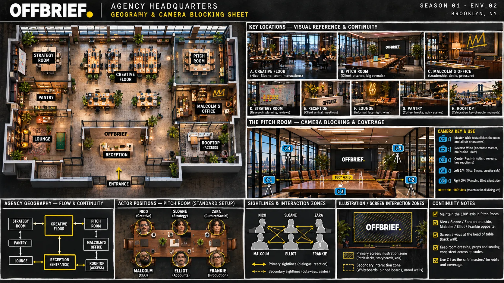

# OFFBRIEF. S01E01 · THE PRODUCT IS MISSING — 30-second Blender previs

A 30-second cinematic previs of the approved ten-frame storyboard. It is staged in one continuous Brooklyn pitch room:

- **Format:** 720 frames at 24 fps (frames 1–720), 16:9.
- **Scene file:** set to 1920×1080.
- **This delivery:** rendered at **144p (256×144)**, as requested.

Built and rendered in **Blender 5.2.4 LTS** (headless Eevee, CPU only). The `.blend` will not open correctly in Blender 4.x.

## Deliverables

| File | What it is |
|---|---|
| `deliverables/OFFBRIEF_S01E01_PREVIS_144P.mp4` | The previs: 256×144, 24 fps, 720 frames, H.264 + AAC (room tone and BOX_01 foley). No overlays: no timecode, shot numbers, subtitles, labels or camera data. |
| `scenes/OFFBRIEF_S01E01_MASTER.blend` | The editable master scene. It has one camera-cut timeline: 10 markers bound to cameras. |
| `reports/camera_cut_timeline.{md,json}` | Shots, frame ranges, camera and set-up, lens, position and rotation, focus distance, dialogue timing. |
| `reports/actor_position_continuity.{md,json}` | Each actor's root, yaw, pelvis height and shoe soles, sampled across the cut, plus which shots each actor appears in. |
| `reports/box01_trajectory.{md,json}` | BOX_01 per-frame position, phase (screen / airborne / grounded), support surface, height and shadow alpha. |
| `reports/contact_occlusion_validation.{md,json}` | 29 measured checks. **All pass** on the current build. |

## What was not available, and what was done instead

- **Character identity sheets (NICO_01, SLOANE_01, ELLIOT_01) and BOX_01 / ILLUSTRATION_01 sheets were not supplied.** Only the storyboard, ENV_01, ENV_02 and PROP_01 were.
  - **Humans:** faceless proxies on armatures. No faces were generated or invented. Each has only small eye markers so eyelines read.
  - **Wardrobe and hair follow the storyboard:**
    - **Nico:** denim jacket, white tee, curly hair, moustache, gold aviators.
    - **Sloane:** black sleeveless top, dark up-do, gold hoops, necklace.
    - **Elliot:** striped shirt, red suspenders, red tie, glasses, moustache, tablet.
  - **Swapping in approved art:** cut-out image planes of the approved sheets can be parented to the `head` bones.
- **BOX_01** is redrawn flat from the storyboard by `scripts/art_box.py`, as layered PNGs in `art/`:
  - kraft-paper box, red identification stripe, black ink outlines;
  - white gloves, small red sneakers;
  - eyes in open / happy / sad and mouths in open / smile / sad.
  - To use the approved artwork, replace the PNGs (same names, same canvas) and rebuild.
- **Dialogue is not voiced.** This machine has no voice recordings and no TTS. The MP4 carries only:
  - low office room tone;
  - subtle cardboard foley for BOX_01: steps, drop, landing, flaps, slump.
  - Line timing is in `reports/camera_cut_timeline.json`.
  - Each actor has a positioned `SPK_DIALOGUE_*` speaker in `AUDIO/DIALOGUE`, ready for recorded lines. The client's speaker sits at the client's chair, off-screen right of the shot 09 master.
- **Script vs. storyboard:** the dialogue is the storyboard's. ENV_02 lists six seats; this episode uses four actors (Nico, Sloane, Elliot, Vanta client) plus two empty chairs.

## Geography (one room, never mirrored)



- **Axes:** metres, room centre at the origin; +Y is north (the presentation wall), +X is east.
- **Room:** 9 × 7 × 3.5 m.
- **Walls:**
  - **West:** black-steel industrial windows with a skyline (camera-left in the master).
  - **East:** glass partitions and the door to the creative floor.
  - **North and south:** exposed brick.
- **Table:** reclaimed-wood conference table, 3.6 × 1.25 m, centre (0, 0.5), top at 0.75 m.
- **Screen:** 85" display centred (0, 3.415, 1.62) over a walnut sideboard (top 0.90 m).
- **Lighting:**
  - daylight sun plus window fill at 5600 K;
  - five 3200 K pendants;
  - fixed bounce lights.
  - Nothing changes between shots.
- **Cast:**
  - **NICO_01:** seated, (−1.05, −0.40).
  - **SLOANE_01:** seated, (−1.05, 1.00).
  - **ELLIOT_01:** standing beside the screen, (1.45, 2.85), holding a tablet.
  - **VANTA_CLIENT:** seated at the camera side of the table, (0.95, −0.82).
- **Cameras:** all six look north.
  - **180° rule:** window-side actors (Nico, Sloane) stay screen-left of the client and screen-side actors (Elliot). The validation report checks this in every shot where both appear.

## Shots

| # | Frames | Camera / set-up | Lens | Beat |
|---|---|---|---|---|
| 01 | 1–72 | CAM_MASTER A | 35 mm | Master. ELLIOT: "Good news. We got the brief." |
| 02 | 73–120 | CAM_SLOANE A | 50 mm | Sloane studies the brief, looks up. "Where's the product?" |
| 03 | 121–192 | CAM_ELLIOT A | 50 mm | Elliot with the tablet. "They haven't invented it yet." |
| 04 | 193–240 | CAM_SLOANE B | 50 mm | Two-shot. SLOANE: "Then what are we selling?" NICO: "Anticipation." |
| 05 | 241–312 | CAM_NICO A | 50 mm | "People don't buy products. They buy possibilities." One open-hand gesture. |
| 06 | 313–360 | CAM_BOX A | 65 mm | The slide switches; BOX_01 appears on the illustration panel and waves. |
| 07 | 361–408 | CAM_TRANSITION A | 35 mm | BOX_01 steps through the screen plane onto the sideboard, leaps and lands on the table (frame 400–401). |
| 08 | 409–456 | CAM_BOX B | 65 mm | BOX_01 opens its flaps: empty. SLOANE (off-screen): "There's literally nothing inside." |
| 09 | 457–624 | CAM_MASTER B | 35 mm | NICO: "Exactly. Unlimited potential." CLIENT (O.S.): "I love it. Can we sell the box?" |
| 10 | 625–720 | CAM_SLOANE C | 50 mm | SLOANE: "That's not the product." BOX_01 slumps, sad. |

- **Camera set-ups:** a camera with several set-ups (A/B/C) holds a constant key at each shot start, so its position changes only on a cut.
- **No handheld:** no camera has handheld shake.

## BOX_01 rig and the screen-to-table transition

- **One rig, start to finish:** `ILLUSTRATION/BOX_01_WORLD` is one continuous object. It is the on-screen illustration in shot 06 and the tabletop character afterwards. It is never swapped, morphed or duplicated.
  - **Hierarchy:** `BOX_01` (path) → `BOX_01_FACING` (yaw) → `BOX_01_SQUASH` (squash & stretch) → art cards.
- **Flat 2D cards:** shadeless ink cards with a binary alpha cut-out. Face cards sit 2 mm in front of the body; gloves and sneakers ride on limb pivots.
- **Limited perspective rotation:** the yaw turns toward each shot's camera at 85 %, clamped to ±40°.
- **Constant size:** one art scale (0.40 m per 1000 px) is used throughout.
- **Stepped animation:** a STEPPED F-curve modifier (step 2) on all BOX_01 motion gives 12 fps holds on the 24 fps timeline.
- **The path:**
  1. Revealed 1 cm in front of the display (frame 313).
  2. Steps through the screen plane (361–368).
  3. Drops onto the sideboard (372) and walks to its front edge (376–388).
  4. Crouches (390), leaps, and lands with both feet on the tabletop (400–401) with squash, stretch and settle.
- **Contact shadow:** `BOX_01_CONTACT_SHADOW` sits on whatever surface is under BOX_01. It fades with height and is off while BOX_01 is part of the illustration.

## Rebuild and render

```bash
python3 scripts/art_box.py                                   # BOX_01 layers + slides
python3 scripts/audio.py                                     # room tone + foley
blender -b --factory-startup --python scripts/build.py       # -> scenes/OFFBRIEF_S01E01_MASTER.blend
blender -b scenes/OFFBRIEF_S01E01_MASTER.blend --python scripts/reports.py
# 144p (this delivery): about 4.5 s/frame on this 4-core CPU, two jobs in parallel, about 55 min
blender -b scenes/OFFBRIEF_S01E01_MASTER.blend --python scripts/render.py -- --range 1 720 --res 256 144 --samples 2 --fast --out deliverables/frames_144p
scripts/encode.sh deliverables/frames_144p deliverables/OFFBRIEF_S01E01_PREVIS_144P.mp4
# full 1080p: drop --res/--fast, raise --samples (estimate before running: several hours on CPU)
```

`scripts/shotlist.py` holds all the data: room, cast, gaze schedule, torso and hand keys, the BOX_01 path and expressions, and the camera set-ups. Edit it and rebuild.
